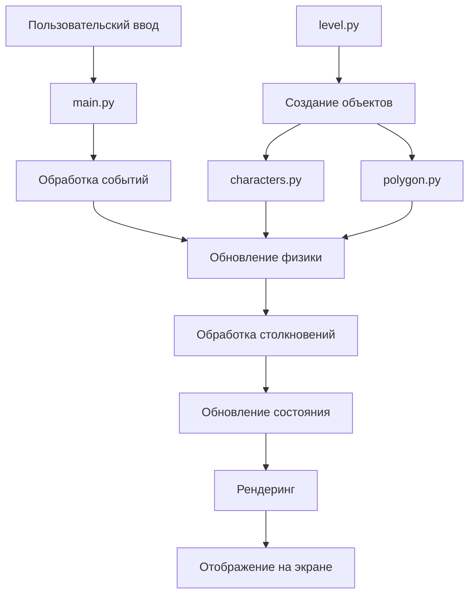
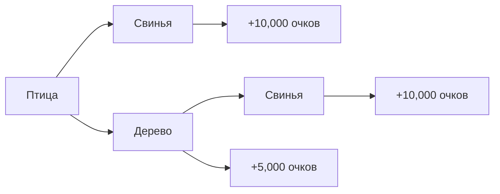

# Angry Birds на Python

Angry Birds, реализованный на Python с использованием библиотек Pygame и Pymunk для физического движка.

## Как играть

### Основная механика
- **Цель**: Уничтожить всех свиней (зеленые круги) на уровне
- **Управление**: Натяните рогатку мышкой и отпустите для запуска птицы
- **Физика**: Реалистичная физика с гравитацией, столкновениями и разрушением конструкций

### Управление
- **Мышь**: Натягивание и запуск птиц
- **S**: Включить режим "нулевой гравитации" (уменьшенная гравитация)
- **N**: Вернуться к нормальной гравитации
- **W**: Включить/выключить правую стену
- **ESC**: Выход из игры
- **Пауза**: Клик по кнопке паузы

### Система очков
- Уничтожение свиньи: +10,000 очков
- Разрушение деревянных блоков: +5,000 очков
- Бонус за оставшихся птиц: +10,000 за каждую птицу

## 1. Структура проекта

```
angry-birds/
├── src/
│   ├── main.py          # Главный файл игры
│   ├── characters.py    # Классы птиц и свиней
│   ├── level.py         # Система уровней
│   └── polygon.py       # Геометрические объекты
├── resources/
│   ├── images/          # Графические ресурсы
│   │   ├── red-bird3.png
│   │   ├── background3.png
│   │   ├── sling-3.png
│   │   ├── wood.png
│   │   ├── wood2.png
│   │   └── ... (другие изображения)
│   └── sounds/          # Звуковые эффекты
│       └── angry-birds.ogg
└── requirements.txt     # Зависимости проекта
```

## 2. Описание файлов

### `src/main.py` - Главный файл игры
**Назначение**: Основной игровой цикл, обработка событий, рендеринг

**Ключевые функции**:
- `sling_action()` - Логика рогатки и натяжения
- `post_solve_bird_pig()` - Обработка столкновений птица-свинья
- `post_solve_bird_wood()` - Обработка столкновений птица-дерево
- `draw_level_cleared()` - Отображение экрана победы
- `restart()` - Перезапуск уровня

**Связи**: Импортирует `Bird`, `Level`, использует `pygame` и `pymunk`

**Логика**:
- Инициализация физического движка Pymunk
- Основной игровой цикл с обработкой событий
- Система столкновений и подсчета очков
- Рендеринг всех игровых объектов

### `src/characters.py` - Игровые персонажи
**Назначение**: Определение классов птиц и свиней

**Ключевые классы**:
- `Bird` - Класс птицы с физическими свойствами
- `Pig` - Класс свиньи-цели

**Свойства объектов**:
- Масса, радиус, упругость, трение
- Система здоровья (life)
- Типы столкновений (collision_type)

**Связи**: Использует `pymunk` для физики

### `src/level.py` - Система уровней
**Назначение**: Создание и управление игровыми уровнями

**Ключевые методы**:
- `build_0()` до `build_11()` - Конфигурации уровней
- `open_flat()`, `closed_flat()` - Создание структур
- `horizontal_pile()`, `vertical_pile()` - Создание свай
- `load_level()` - Загрузка уровня по номеру

**Структуры уровней**:
- Различные комбинации деревянных блоков
- Размещение свиней
- Настройка количества птиц и очков

**Связи**: Импортирует `Pig`, `Polygon`

### `src/polygon.py` - Геометрические объекты
**Назначение**: Создание и отрисовка деревянных конструкций

**Ключевые методы**:
- `draw_poly()` - Отрисовка балок и колонн
- `to_pygame()` - Конвертация координат Pymunk в Pygame

**Типы объектов**:
- Балки (beams) - горизонтальные элементы
- Колонны (columns) - вертикальные элементы

**Связи**: Использует `pygame` для отрисовки, `pymunk` для физики

## 3. Архитектура проекта

### Общая структура
```
┌─────────────────┐    ┌─────────────────┐    ┌─────────────────┐
│   main.py       │    │  characters.py  │    │   level.py      │
│   (Игровой цикл)│◄──►│  (Персонажи)    │◄──►│  (Уровни)       │
└─────────────────┘    └─────────────────┘    └─────────────────┘
         │                       │                       │
         ▼                       ▼                       ▼
┌─────────────────┐    ┌─────────────────┐    ┌─────────────────┐
│   pygame        │    │    pymunk       │    │  polygon.py     │
│   (Графика)     │    │   (Физика)      │    │ (Конструкции)   │
└─────────────────┘    └─────────────────┘    └─────────────────┘
```

### Потоки данных



### Система столкновений



## 4. Библиотеки/фреймворки

### Pygame (2.1.3)
**Назначение**: Графический движок и обработка событий
**Использование**:
- Отрисовка всех игровых объектов
- Обработка пользовательского ввода
- Управление звуком
- Создание окна и поверхности

### Pymunk (6.0.0)
**Назначение**: Физический движок для 2D симуляции
**Использование**:
- Симуляция гравитации и движения
- Обработка столкновений между объектами
- Создание физических тел (круги, полигоны)
- Управление импульсами и силами

### Дополнительные зависимости
- **cffi (1.15.1)**: Интерфейс для C-библиотек
- **pycparser (2.21)**: Парсер C-кода для cffi

## 5. Точка входа и запуск

### Запуск проекта
```bash
# Установка зависимостей
pip install -r requirements.txt

# Запуск игры
cd src
python main.py
```

### Последовательность инициализации
1. **Импорт модулей**: pygame, pymunk, пользовательские классы
2. **Инициализация Pygame**: Создание окна, загрузка ресурсов
3. **Настройка физики**: Создание пространства Pymunk, гравитация
4. **Создание уровня**: Инициализация класса Level
5. **Настройка обработчиков столкновений**
6. **Запуск игрового цикла**

### Главный цикл
```python
while running:
    # Обработка событий
    # Обновление физики
    # Отрисовка
    # Обновление экрана
```

## 6. Архитектурные особенности

### Модульная архитектура
- **Разделение ответственности**: Каждый файл отвечает за свою область
- **Слабая связанность**: Модули взаимодействуют через четко определенные интерфейсы
- **Высокая когезия**: Связанная функциональность сгруппирована вместе

### Физический движок
- **Реалистичная физика**: Использование Pymunk обеспечивает точную симуляцию
- **Система столкновений**: Автоматическое определение и обработка столкновений
- **Настраиваемые параметры**: Упругость, трение, масса для каждого объекта

### Система уровней
- **Процедурная генерация**: Уровни создаются программно
- **Масштабируемость**: Легко добавлять новые уровни
- **Настройка сложности**: Различные параметры для каждого уровня

### Оптимизация производительности
- **Двойное обновление физики**: `space.step(dt)` вызывается дважды за кадр
- **Эффективная отрисовка**: Использование subsurface для спрайтов
- **Управление памятью**: Автоматическое удаление объектов за пределами экрана

### Особенности реализации
- **Координатные системы**: Конвертация между Pymunk и Pygame координатами
- **Система очков**: Динамический подсчет с бонусами
- **Режимы игры**: Нулевая гравитация и управляемые стены
- **Траектория птиц**: Визуализация пути полета

Подпись относится к текущей версии проекта.

---

Автор: legenda  
Telegram: [@LEGENDA_SD](https://t.me/LEGENDA_SD)
